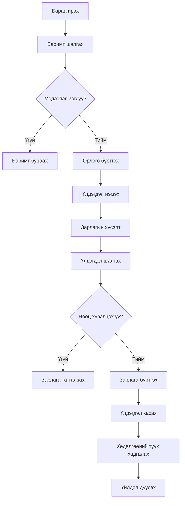

# L03 — Агуулахын процессын зураглал

## 1. Үндсэн процесс

## 2. Процессын тайлбар

1. Бараа агуулахад ирнэ.
2. Баримтын мэдээллийг шалгана.
3. Бараа зөв бол орлого бүртгэнэ.
4. Үлдэгдлийг нэмэгдүүлнэ.
5. Зарлагын хүсэлт ирнэ.
6. Систем үлдэгдлийг шалгана.
7. Нөөц хүрэлцвэл зарлага бүртгэнэ.
8. Үлдэгдлийг бууруулна.
9. Хөдөлгөөний түүхийг хадгална.

## 3. Дүгнэлт

Процессын зураглалаар барааны орлого болон зарлагын үндсэн дарааллыг харуулсан.
